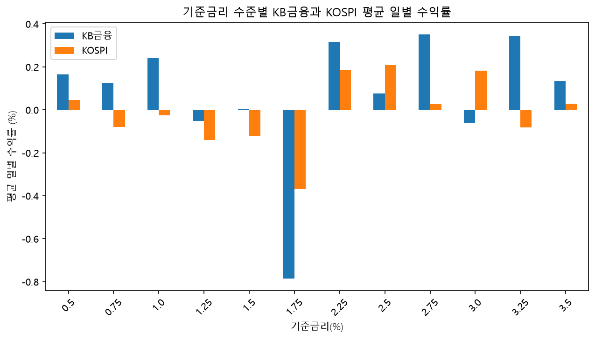
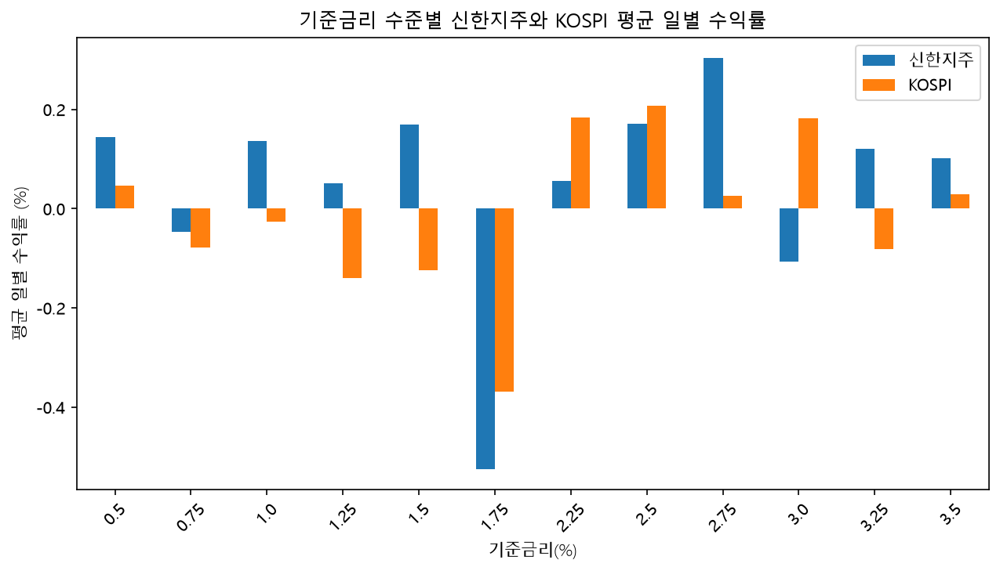
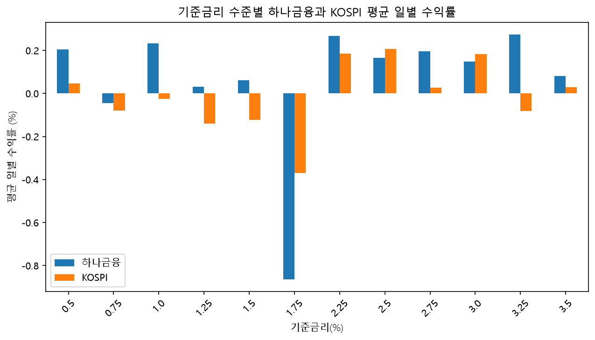
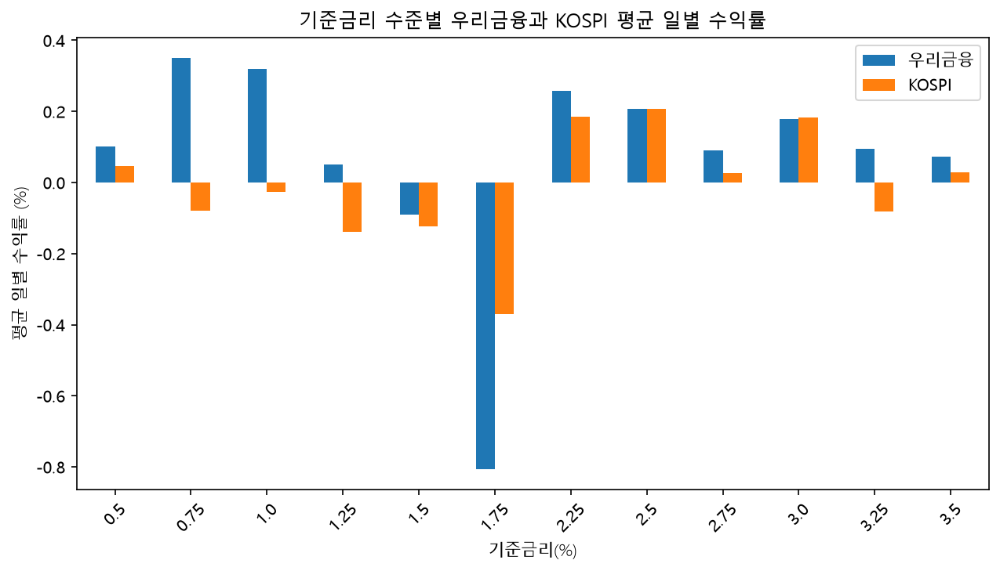

## 1. 분석 목적

금융권에 대한 관심을 바탕으로 금융 데이터를 직접 분석해 보고자 이 프로젝트를 시작했다. 2021~2025년 KB금융, 신한지주, 하나금융, 우리금융의 주가 데이터를 이용해 다음 내용을 살펴봤다.

- **은행별 비교:** 어느 은행의 평균 일별 수익률이 높았고, 하루하루 수익률이 더 크게 오르내렸는지 비교했다.
- **주식시장과의 관계:** KOSPI 수익률이 높은 날 은행주 수익률도 높은 경향이 있었는지 확인했다.
- **환율과의 관계:** 환율이 많이 오른 날 은행주 수익률은 어떤 경향을 보였는지 살펴봤다.
- **기준금리별 비교:** 기준금리 수준에 따라 은행주의 평균 일별 수익률이 어떻게 달랐는지 비교했다.

## 2. 데이터 출처

### 주가 및 KOSPI

Python의 FinanceDataReader를 이용해 은행주 4종과 KOSPI의 일별 데이터를 수집했다.

- 수집 요청 기간: 2021-01-01~2025-12-31
- 수집 결과: 각 데이터 1,225행
- 분석에 사용한 값: 일별 종가

| 대상 | 수집 코드 |
|---|---|
| KB금융 | 105560 |
| 신한지주 | 055550 |
| 하나금융지주 | 086790 |
| 우리금융지주 | 316140 |
| KOSPI | KS11 |

### 환율

미국 1달러를 원화로 바꿀 때의 환율을 사용했다. FinanceDataReader를 통해 FRED의 일별 환율 자료를 수집했다.

- 제공 서비스: FRED
- 원자료 제공 기관: 미국 연방준비제도 이사회
- 자료 코드: DEXKOUS
- 수집 요청 기간: 2021-01-01~2025-12-31
- 단위: 원/달러 — 미국 1달러당 원화 금액
- 자료 주소: [FRED DEXKOUS](https://fred.stlouisfed.org/series/DEXKOUS)

### 기준금리

한국은행의 「한국은행 기준금리 추이」에서 금리가 변경된 날짜와 해당 금리를 확인해 표로 정리했다.

- 출처: 한국은행
- 수집 범위: 2020-05-28~2025-05-29의 기준금리 변경 내역
- 단위: %
- 자료 주소: [한국은행 기준금리 추이](https://www.bok.or.kr/portal/singl/baseRate/list.do?menuNo=200643)

분석 시작일인 2021-01-01에 적용되던 금리를 확인하기 위해 2020-05-28 자료도 포함했다. 각 주식 거래일에는 그날까지 가장 최근에 변경된 기준금리를 연결했다.

## 3. 전처리

### 원본과 정제 데이터 분리

수집한 원본 데이터는 PostgreSQL의 raw 스키마에 보관하고, 분석에 사용할 수 있도록 정리한 데이터는 clean 스키마에 따로 저장했다. 원본을 유지해 정리 전후의 데이터를 확인할 수 있도록 했다.

### 날짜와 숫자의 자료형 정리

날짜는 DATE로, 주가·환율·기준금리 등 계산에 사용할 값은 숫자형으로 변환했다. 데이터별 행 수, 날짜 범위, 날짜 중복과 결측값도 확인했다.

### 주식 거래일을 기준으로 데이터 연결

은행 주가와 KOSPI는 같은 날짜끼리 연결했다. 환율도 주식 거래일과 같은 날짜의 값을 연결하되, 해당 날짜에 환율 자료가 없더라도 주가 데이터는 남겨 두었다.

### 환율 결측값 처리

주식 거래일에 환율 자료가 없는 경우, 이전 값으로 임의로 채우지 않고 NULL로 유지했다. 환율과 수익률의 관계를 계산할 때는 계산에 필요한 값이 있는 자료를 사용했다.

### 거래일별 기준금리 연결

기준금리는 매일 새로 기록되는 자료가 아니라 금리가 변경된 날짜에 기록되는 자료다. 따라서 각 주식 거래일을 기준으로, 그날까지 가장 최근에 변경된 금리를 찾아 연결했다.

## 4. 분석 과정

### 일별 수익률 계산

은행주 4종과 KOSPI의 종가를 이용해 전 거래일보다 얼마나 오르거나 내렸는지 계산했다.

- 일별 수익률(%) = (당일 종가 - 전 거래일 종가) / 전 거래일 종가 × 100
- SQL의 LAG 함수로 전 거래일 종가를 가져왔다.
- 첫 거래일은 비교할 이전 종가가 없어 수익률을 계산하지 않았다.

### 은행별 수익률과 변동성 비교

은행별로 일별 수익률의 산술평균을 계산해 하루 평균 수익률을 비교했다. 일별 수익률의 표본표준편차를 계산해 수익률이 얼마나 크게 오르내렸는지 나타내는 변동성도 비교했다.

### KOSPI와의 관계 분석

같은 거래일의 은행 수익률과 KOSPI 수익률 사이의 상관계수를 계산했다. 이를 통해 시장 수익률이 높은 날 은행주 수익률도 높은 경향이 있었는지 확인했다.

### 환율 변화율과의 관계 분석

환율 변화율은 KB금융의 주식 거래일을 기준으로 계산했다.

- 환율 변화율(%) = (당일 환율 - 직전 주식 거래일의 환율) / 직전 주식 거래일의 환율 × 100
- 당일 또는 직전 주식 거래일의 환율이 없으면 변화율을 계산하지 않았다.
- 은행 수익률과 환율 변화율이 모두 있는 날짜만 관계 분석에 사용했다.

환율 변화율과 은행 일별 수익률 사이의 상관계수를 계산했다. 환율 변화율 하나를 사용한 단순 직선 회귀모형의 기울기와 결정계수도 계산했다.

상관계수로 관계의 방향과 강도를 확인하고, 결정계수로 이 직선 모형이 은행 수익률의 변동을 얼마나 설명하는지 확인했다. 연도별로 나누어 관계가 달라지는지도 살펴봤다.

### 기준금리 수준별 비교

은행별로 같은 기준금리가 적용된 거래일들을 묶어 거래일 수, 평균 일별 수익률과 변동성을 계산했다. Python으로 은행과 KOSPI의 평균 일별 수익률을 나란히 그려 금리 수준별 차이를 비교했다.

## 5. 분석 결과

### 은행별 수익률·변동성과 KOSPI 비교

2021~2025년 자료에서 은행별로 1,224일의 일별 수익률을 분석했다.

| 대상 | 평균 일별 수익률(%) | 일별 수익률 변동성(표준편차, %p) | KOSPI와의 상관계수 |
|---|---:|---:|---:|
| KB금융 | 0.1102 | 2.1105 | 0.4745 |
| 신한지주 | 0.0895 | 1.8277 | 0.4872 |
| 우리금융 | 0.1032 | 1.7309 | 0.4973 |
| 하나금융 | 0.1056 | 2.0598 | 0.4993 |
| KOSPI | 0.0361 | 1.1633 | — |

평균 일별 수익률은 일별 수익률의 산술평균이며, 변동성은 일별 수익률의 표본표준편차다. 수치는 소수점 넷째 자리까지 반올림했다.

- 은행주 4종 모두 KOSPI보다 평균 일별 수익률과 변동성이 높았다.
- KB금융은 은행주 4종 중 평균 일별 수익률이 가장 높았고, 하루하루 수익률이 오르내리는 폭도 가장 컸다.
- 은행주 4종 모두 KOSPI와 양의 상관관계를 보였다. 시장 수익률이 높은 날에는 은행주 수익률도 대체로 높은 경향이 있었다.
- KOSPI와의 상관계수는 약 0.47~0.50이었다. 하나금융이 가장 높았지만 은행 간 차이는 작았다.

### 환율 변화율과 은행 수익률의 관계

은행 수익률과 환율 변화율을 모두 계산할 수 있는 날짜만 사용했다. 분석에 사용한 거래일 수는 은행별 1,136일이다.

| 은행 | 환율 변화율과의 상관계수 | 결정계수(R²) |
|---|---:|---:|
| KB금융 | -0.2121 | 0.0450 |
| 신한지주 | -0.1997 | 0.0399 |
| 우리금융 | -0.2043 | 0.0417 |
| 하나금융 | -0.1989 | 0.0396 |

수치는 소수점 넷째 자리까지 반올림했다.

- 은행주 4종 모두 환율 변화율과 약한 음의 상관관계를 보였다. 환율이 많이 오른 날에는 은행주 수익률이 대체로 낮은 경향이 있었다.
- 환율 변화율 하나를 사용한 직선 회귀모형의 결정계수는 약 0.040~0.045였다. 은행 일별 수익률 변동의 약 4~4.5%를 설명하는 수준으로, 이 모형의 설명력은 낮았다.
- KOSPI 등 다른 요인의 영향을 구분하지 않았으므로, 환율이 은행주 수익률 하락의 원인이라고 단정할 수 없다.

### 연도별 환율 관계 비교

전체 기간의 결과가 매년 비슷하게 나타나는지 확인하기 위해 연도별로 나누어 분석했다.

#### 환율 변화율과 은행 수익률의 상관계수

| 연도 | KB금융 | 신한지주 | 우리금융 | 하나금융 |
|---|---:|---:|---:|---:|
| 2021 | -0.1355 | -0.2742 | -0.2597 | -0.1966 |
| 2022 | -0.4199 | -0.3947 | -0.3212 | -0.3994 |
| 2023 | -0.2506 | -0.2078 | -0.1681 | -0.1678 |
| 2024 | -0.1107 | -0.1331 | -0.1399 | -0.1473 |
| 2025 | -0.1656 | -0.0775 | -0.1285 | -0.0926 |

#### 환율 변화율 하나를 사용한 직선 회귀모형의 결정계수

| 연도 | KB금융 | 신한지주 | 우리금융 | 하나금융 |
|---|---:|---:|---:|---:|
| 2021 | 0.0184 | 0.0752 | 0.0674 | 0.0386 |
| 2022 | 0.1763 | 0.1558 | 0.1032 | 0.1595 |
| 2023 | 0.0628 | 0.0432 | 0.0283 | 0.0282 |
| 2024 | 0.0122 | 0.0177 | 0.0196 | 0.0217 |
| 2025 | 0.0274 | 0.0060 | 0.0165 | 0.0086 |

수치는 소수점 넷째 자리까지 반올림했다. 분석에 사용한 거래일 수는 은행별로 2021년 229일, 2022년 228일, 2023년 229일, 2024년 226일, 2025년 224일이다.

- 모든 은행이 모든 연도에서 음의 상관관계를 보였지만, 관계의 강도는 연도마다 달랐다.
- 네 은행 모두 2022년에 상관계수의 절댓값이 가장 컸다. 다른 분석 연도보다 환율 변화율이 높은 날 은행 수익률이 낮은 경향이 더 뚜렷했다.
- 2022년의 결정계수는 약 0.103~0.176으로, 모형이 은행 수익률 변동의 약 10.3~17.6%를 설명했다. 다른 연도보다 설명력이 높았지만, 변동의 상당 부분은 설명하지 못했다.
- 따라서 전체 기간의 평균적인 관계만으로 모든 연도의 특징을 설명하기에는 한계가 있다.

### 기준금리 수준별 은행 수익률 비교

은행별로 기준금리 수준에 따른 평균 일별 수익률을 계산하고 KOSPI와 비교했다.

#### KB금융

#### 신한지주

#### 하나금융

#### 우리금융

- 네 은행 모두 기준금리가 높을수록 평균 일별 수익률이 일관되게 높아지는 모습은 나타나지 않았다.
- 예를 들어 하나금융은 기준금리 3.25% 구간보다 3.5% 구간에서 평균 일별 수익률이 낮았다.
- 그래프는 시간순이 아니라 기준금리 크기순으로 정렬했다. 따라서 금리가 변경된 직후의 주가 반응을 보여 주는 것은 아니다.

금리 구간별 거래일 수도 차이가 있었다. 우리금융에서 거래일 수가 가장 적은 구간과 가장 많은 구간은 다음과 같다.

| 구분 | 기준금리 | 거래일 수 |
|---|---:|---:|
| 가장 적은 구간 | 1.50% | 29일 |
| 가장 많은 구간 | 3.50% | 424일 |

거래일 수가 적은 구간의 평균은 일부 거래일의 큰 등락에 더 민감할 수 있다. 또한 금리 구간마다 당시 시장 상황도 다르므로, 수익률 차이를 기준금리 자체의 효과로 단정하기 어렵다.

## 6. 인사이트

### 평균 수익률과 변동성을 함께 봐야 한다

은행주 4종은 KOSPI보다 평균 일별 수익률이 높았지만, 수익률이 오르내리는 폭도 컸다. 특히 KB금융은 평균 일별 수익률과 변동성이 모두 가장 높았다. 따라서 평균 수익률이 높다는 점만으로 분석 대상을 평가하기보다 변동성도 함께 살펴볼 필요가 있다.

### 전체 기간의 결과만 보면 연도별 차이를 놓칠 수 있다

환율 변화율과 은행 수익률은 전체 기간에서 약한 음의 관계를 보였지만, 연도별로 관계의 강도가 달랐다. 네 은행 모두 2022년에 음의 관계가 가장 뚜렷했다. 전체 기간의 요약값과 시기별 결과를 함께 확인해야 한다.

### 금리 수준만으로 은행 수익률을 설명하기 어렵다

기준금리가 높은 구간에서 은행 수익률이 항상 높지는 않았다. 금리 구간별 수익률 차이를 해석할 때는 거래일 수와 당시 시장 상황도 함께 고려해야 한다.

## 7. 한계

- **분석 대상과 기간:** 은행주 4종과 2021~2025년 자료를 분석한 결과이므로, 다른 업종이나 다른 기간에도 같은 관계가 나타난다고 일반화하기 어렵다.
- **수익률의 범위:** 종가 변화로 계산한 수익률이며 배당금을 별도로 반영하지 않았다. 평균 일별 수익률은 전체 기간의 누적 수익률과도 다르다.
- **다른 요인 미반영:** 환율 회귀모형에는 환율 변화율 하나만 사용했다. KOSPI, 기업 실적 등 다른 요인의 영향을 구분하지 않았으므로 인과관계를 단정할 수 없다.
- **환율 자료의 결측:** 필요한 값이 없는 날짜는 환율 관계 분석에서 제외했다. 따라서 환율 분석과 전체 주가 분석에 사용된 거래일 수가 다르다.
- **관측 시각 차이:** FRED 환율은 뉴욕 정오 기준 자료로 한국 주식 종가와 관측 시각이 다르다. 같은 날짜로 연결했더라도 동일한 시점의 값을 비교한 것은 아니다.
- **기준금리 비교 방식:** 금리 구간마다 거래일 수와 해당 시기가 다르다. 이번 분석은 금리 수준별 평균을 비교한 것으로, 금리 변경 직후의 효과를 따로 분석한 것은 아니다.